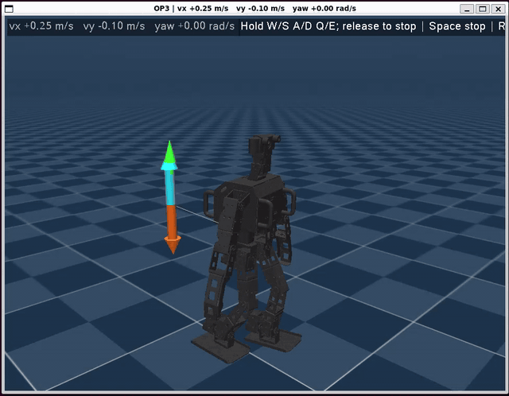

# OP3 locomotion with MJX and PPO

Train a Robotis OP3 walking policy with PPO using JAX, MuJoCo MJX, and Brax.

The GIF shows the [40M scratch run](configs/upright_contact_area_scratch_40m.json),
trained from scratch with these rewards and **no torque symmetry penalty**:

| Reward | What it does | Weight |
| --- | --- | ---: |
| Linear velocity tracking | Follows commanded forward and lateral velocity. | +3.0 |
| Yaw rate tracking | Follows commanded turning speed. | +1.0 |
| Upright posture | Keeps the torso upright. | +3.0 |
| Vertical velocity | Penalizes vertical body motion. | −0.5 |
| Roll/pitch velocity | Penalizes body rotation around roll and pitch axes. | −0.05 |
| Actuator effort | Penalizes large actuator torques. | −0.002 |
| Action changes | Penalizes abrupt changes in joint targets. | −0.02 |
| Joint limits | Penalizes joint positions outside their limits. | −1.0 |
| Nominal posture | Penalizes deviation from the nominal standing pose. | −0.05 |
| Foot slip | Penalizes sliding feet while in contact with the floor. | −5.0 |
| Foot air time | Rewards time airborne on landing when movement is commanded. | +2.0 |
| Foot contact area | Rewards greater estimated sole area near the floor for feet bearing weight. | +0.5 |
| Termination | Penalizes falls or invalid simulation states. | −2.0 |

The weighted reward is scaled by the 0.02 s control timestep.
